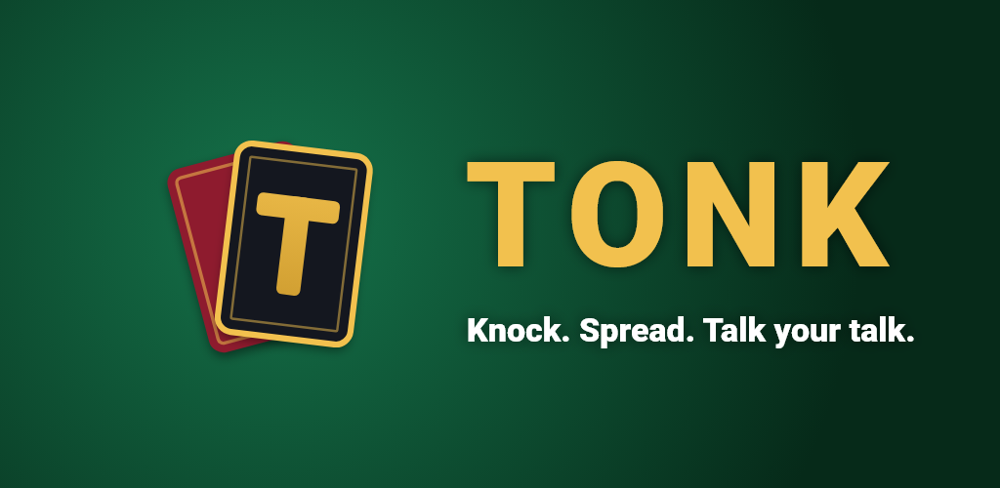
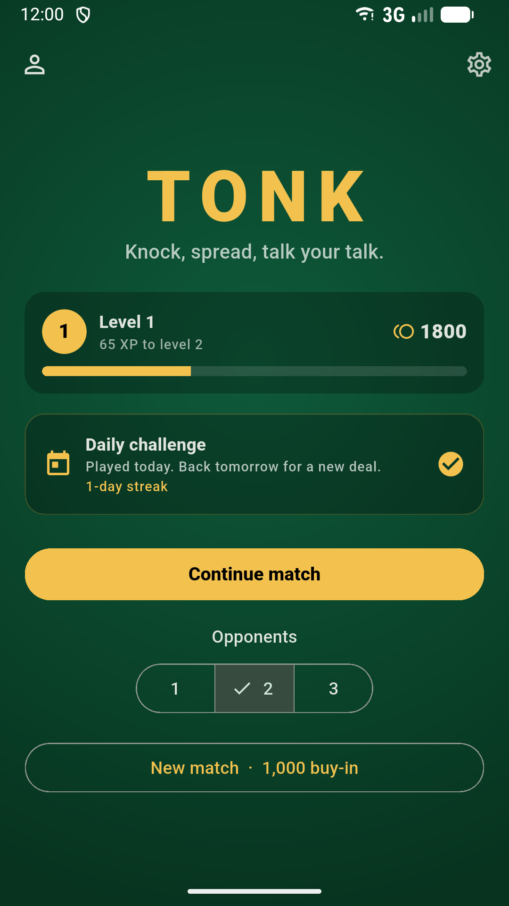
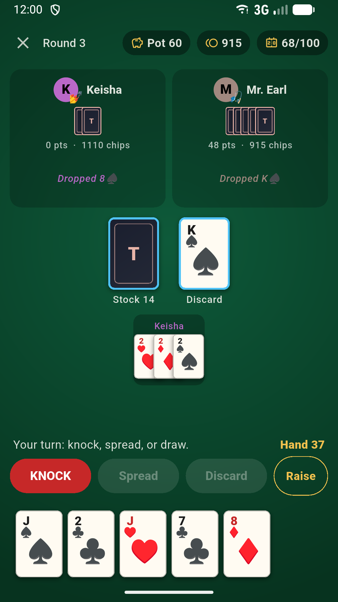
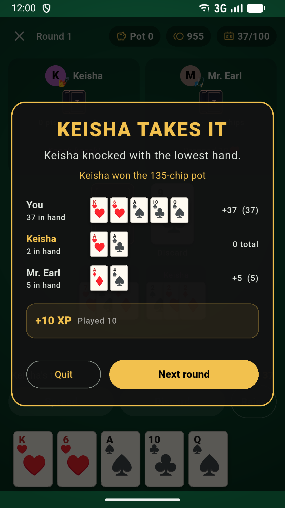
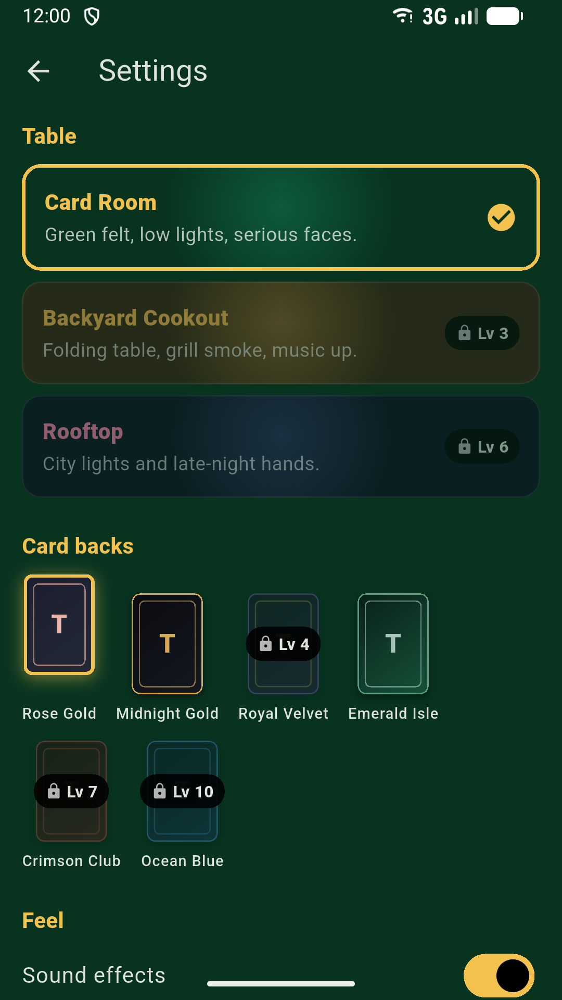

<p align="center">
  
</p>

<p align="center">
  <a href="https://github.com/naperry2011/tonk/actions/workflows/ci.yml"></a>
  
  
  
  
</p>

<h3 align="center">Pull up a chair. The cookout card game, in your pocket.</h3>

<p align="center">
  Lay your spreads, hit theirs, and knock when you think you're holding the lowest hand.<br>
  Guess wrong and the table <i>will</i> let you hear about it.
</p>

---

## The Table

<p align="center">
  
  &nbsp;
  
  &nbsp;
  
  &nbsp;
  
</p>

## Two Ways to Play

| | **Mobile app** (`app/`) | **Web game** (repo root) |
|---|---|---|
| **Stack** | Flutter, pure Dart engine | Vanilla JavaScript, Vite |
| **Platforms** | Android, iOS | Any browser |
| **Opponents** | 7 characters with personalities and table talk | 1-3 AI players |
| **Betting** | Ante, raise, call, or fold | Ante and raise |
| **Progression** | XP, levels, unlocks, achievements, daily challenge | Win/loss stats |
| **Style** | 3 tables, 6 card backs, sound, haptics | 6 card backs |

Both run offline with no accounts, no ads, and no data collected.

## Meet the Table

Every opponent plays their own way, and talks their own talk.

| Character | Vibe | At the table |
|---|---|---|
| **Uncle Ray** | Never stops talking. Never. | Loves to raise, rarely folds |
| **Aunt Dot** | Runs the table, the kitchen, everything. | Never folds. Ever. |
| **Cousin Dre** | Quiet. Knocks early. Way too early. | Knocks on almost anything |
| **Mr. Earl** | Patient as a fishing trip. | Only knocks when he's sure |
| **Keisha** | Spread queen. | Grabs every card you throw away |
| **Lil Tre** | 19, cocky, knocks on anything. | Raises big, gets caught a lot |
| **Grandma Pearl** | Sweetest lady you know. Ruthless at the table. | Smart, aggressive, unbothered |

New players start with four of them. Level up to bring Aunt Dot, Grandma Pearl, and Cousin Dre to the table. Every line they say lives in [`app/assets/content/characters.json`](app/assets/content/characters.json), and it's kept clean: the tests fail on cursing.

## How Tonk Works

<details open>
<summary><b>The rules in 60 seconds</b></summary>

<br>

**Card values:** Ace = 1, 2 through 10 = face value, J/Q/K = 10.

- **Spreads:** books (3-4 of a rank) or runs (3+ in a row, same suit). You can also hit any spread on the table.
- **Knock:** at the start of your turn, claim the lowest hand. If anyone ties or beats you, you're caught.
- **Tonk:** empty your hand and the round is yours.
- **Initial Tonk:** get dealt 49 or 50 points and you win on the spot. Two players at once? Redeal.
- **Stock runs out:** lowest hand wins.
- **Match:** losers add their hand points to their score. First to 100 loses.
- **Betting:** everyone antes and the winner takes the pot. In the mobile app, passing on a raise means you fold and sit the round out.

</details>

## Mobile App Features

- **Characters with mouths:** reactions to every knock, catch, raise, and Tonk
- **Real betting:** raise, call, or fold, and the AI raises back
- **Bankroll:** chips carry between matches (1,000 buy-in, daily bonus, and a refill if you go broke). Play money only, never sold.
- **Level up:** XP every round unlocks tables, card backs, and tougher opponents
- **Daily challenge:** the same deal for everyone, every day. Keep the streak alive.
- **Achievements and stats:** ten to earn, plus your full table record
- **Feel:** sound effects, haptics, card animations, and confetti when you Tonk
- **Never lose a hand:** every match saves automatically

## Getting Started

### Mobile app

Requires the Flutter SDK (3.44+) and an Android emulator or device.

```bash
cd app
flutter pub get
flutter run
```

```bash
flutter test      # engine, controller, content, and widget tests
flutter analyze
```

### Web game

Requires Node.js (v18+ recommended).

```bash
npm install
npm run dev       # http://localhost:5173
```

```bash
npm test          # Vitest
npm run lint      # ESLint
npm run build     # static build to dist/
```

## Under the Hood

```
app/                      Flutter app (Android + iOS)
  lib/engine/             Pure Dart game engine, no Flutter imports
  lib/state/              Game controller, paced AI turns, table talk
  lib/meta/               XP, levels, bankroll, daily challenge
  lib/ui/                 Screens, widgets, themes, sound and haptics
  assets/content/         The AI roster and every line they say
  tool/                   Generators for sound effects, the icon, and store art
src/                      Web game
  game/                   Game logic (no DOM)
  ui/                     DOM rendering and input
styles/                   Web styles and deck themes
tests/                    Web test suites
store/                    Release kit: checklist, privacy policy, store art
docs/ai/                  Memory, roadmap, tasks, and architecture decisions
```

Highlights:

- **One rulebook, two engines.** The Dart engine is a faithful port of the JS one, tested against the same cases plus a 1,000-round AI-vs-AI simulation that checks every chip and every card.
- **Seeded randomness.** The same seed replays the same game, which is how the daily challenge deals everyone the same hand.
- **Generated, not downloaded.** The sound effects, the app icon, and the store art are all made by scripts in `app/tool/`, so every asset is ours to ship.

CI runs the web lint, tests, and build, plus Flutter analyze and tests, on every push and pull request to `main`.

## Shipping

The release checklist lives in [`store/README.md`](store/README.md): upload key, app bundle, Play Console answers, iOS notes, and listing copy. Tonk includes simulated gambling with play chips, so expect an 18+ rating on the App Store.

## License

MIT
